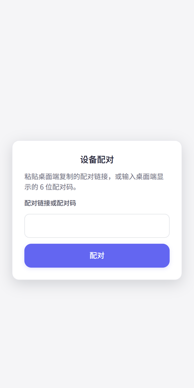

# dsh-mobile · 掌上 dsh

**把 dsh 的会话搬到手机上**：一个 dsh 插件，在宿主上起一个手机端 Web 界面 + `/m/api` RPC 通道，手机浏览器打开就能配对、浏览工作区/会话、实时聊天、审批与提问、切换模型、收发图片，并可安装为 PWA。

English summary: a mobile web surface for [DeepSeek Harness](https://github.com/deepseek-ai/deepseek-harness) — pairing by code, workspace/session browsing, streaming chat (SSE), approvals, model switching, images, PWA. Host half lives in `index.js`; the phone UI is built from the vendored dsh-palm v1.6.0 fork under `mobile-src/`.



## 能力

- **6 位码 / 配对链接**：桌面 dsh 设置页「掌上 dsh」出码，手机 `/m/` 输码，服务端下发 HttpOnly 设备 cookie（设备可在桌面端撤销）。
- **完整手机聊天界面**：会话列表、流式回复（SSE `/m/api/events.mux`）、推理块、工具卡、Markdown/代码块、消息队列、引用、重新生成、搜索。
- **工作区与会话**：浏览 / 新建 / 重命名 / 归档；运行中会话徽标；「最近访问 / 固定 / 运行中」快捷入口。
- **审批与提问**：`mobile.pending` / `mobile.respond`；进入会话自动补发待处理卡片，工作区与会话行有橙条提示。
- **模型**：查看模型目录、切换会话模型与思考强度；默认模型与第三方 provider 在桌面端配置。
- **附件与图片**：相册/拍照上传、聊天图片限高、点击全屏预览；只读截图路由 `/m/shot/<file>` 便于手机直接看主机截图。
- **命令面板**：`/` 面板合并宿主命令、本机动作（文件/模型）与宿主技能目录，中文标题与说明；选中即插入输入框，由宿主的命令通道执行。
- **通知**：浏览器通知 + 推送渠道（WxPusher / Server酱 / Bark / Telegram / PushPlus）+ 可选 Web Push。
- **语音转写**：可配置 OpenAI 兼容的转写服务（按序回退）。
- **设置**：外观/对话等本机项 + 主机配置只读/可写项，逐项标注「本机 / 同步桌面 / 桌面端」。
- **PWA**：可添加到主屏幕，离线壳与更新检查。

## 前置条件

- dsh **>= 0.2.0-rc.1**（见 `package.json` 的 `dsh.engines.dsh`）
- **Node.js >= 20**（插件宿主与 `mobile-src` 构建）
- 手机端浏览器：Chrome / 夸克等 Chromium 内核；HTTPS 环境下 Web Push、剪贴板等能力才可用

## 安装

在桌面 dsh 的插件管理器里把本目录作为本地 bundle 安装（`plugin_manager install_bundle` 指向本仓库根目录或打包出的 `.tgz`），或把本仓库放进 profile 的插件目录后手动加一条 patch：

```yaml
- insert:
    - id: dsh-mobile
      name: 'dsh-mobile'
      config:
        enabled: true
        mobilePort: 19387
        mobileHost: '0.0.0.0'
        pairCode: ''                                # 留空 = 随机 6 位码（5 分钟过期）；固定码则永不过期
        publicBaseUrl: 'https://your-host.example.com:45632'   # 仅用于展示，可留空
```

安装后刷新一次 dsh 页面以加载客户端设置段。

## 快速开始

1. 桌面 dsh：**设置 → 掌上 dsh → 生成配对码**。
2. 手机：打开 `http://<主机IP>:19387/m/`（或公网 `https://your-host.example.com:45632/m/`），输入配对码。
3. 配对后即可进入工作区/会话；聊天页输入框上方工具行有 `+`、模型、命令（`/`）、权限、审批、子代理等入口。

公网访问：本插件监听 `0.0.0.0:<mobilePort>`，前面套一层 HTTPS 反代即可（示例：`https://your-host.example.com:45632` → `192.168.1.10:19387`）。反代必须用 HTTPS，且不要把 19387 的明文端口直接暴露到公网。

## 配置

| 字段 | 默认 | 说明 |
|---|---|---|
| `enabled` | `true` | 关闭后不挂载任何路由 |
| `mobilePort` | `19387` | 手机监听端口（独立于 GUI 的动态端口） |
| `mobileHost` | `0.0.0.0` | 监听地址；只在本机用可改 `127.0.0.1` |
| `pairCode` | 示例配 `''`（随机 6 位、5 分钟过期） | 留空 = 随机码；填固定值则该码**永不过期**（代码内回退值 `123456` 仅供开发，公开部署不要用固定码） |
| `publicBaseUrl` | 空 | 设置面板展示的公网地址，仅展示用途，**留空也不影响运行** |
| `devicesFile` | `~/.dsh/dsh-mobile-devices.json` | 已配对设备与 token 的存储位置 |
| `pushConfigFile` | `~/.dsh/dsh-mobile-push.json` | 推送渠道配置 |
| `hiddenModels` | `[]` | 手机端模型选择器里隐藏的模型 id |

## 架构

```
手机浏览器 / PWA
   │  GET /m/  (HTML + 31 段注入脚本 + theme.css)
   │  POST /m/api/<method>  (63 个 RPC：session/workspace/pair/mobile/…)
   │  GET  /m/api/events.mux (SSE)
   ▼
index.js（宿主半）
   ├─ 双 HTTP 面：GUI webServer（回环，设置面板）+ 0.0.0.0:<port>（手机/局域网/公网）
   ├─ 配对与设备 cookie、审批/提问应答、通知、用量、插件/自动化页数据、命令与技能目录
   └─ 注入脚本（31 段）：在不改 bundle 的前提下补齐工具栏、命令面板、设置范围标签、图片预览等
   ▼
assets/mobile.bundle.js  ←由 mobile-src/ 构建（dsh-palm v1.6.0 fork，见 mobile-src/UPSTREAM.md）
assets/theme.css         ←本仓库自己的样式（实时读盘，改完刷新生效）
```

手机 UI 复用 [dsh-palm](https://github.com/Eternalloveone/dsh-palm) v1.6.0 的 React bundle（源码已 vendor 到 `mobile-src/`，Apache-2.0）；宿主侧 RPC 由本插件按 dsh 原生服务重新实现，而不是沿用 dsh-palm 的 host。

## 开发

```sh
# 1) 构建手机 bundle（源码在 mobile-src/，产物写到 assets/）
cd mobile-src
npm ci
node build.mjs        # 或 npm run build；实测 npm ci ~1.2s、构建 65–80ms，产物 sha256 可复现

# 2) 检查宿主半语法
node --check index.js

# 3) 本地加载验证（插件已装好并监听 19387 时）
curl -s -o /dev/null -w '%{http_code}\n' http://127.0.0.1:19387/m/
```

- `assets/theme.css` 每次请求实时读盘：改完刷新手机页面即生效，无需重启 dsh。
- `index.js` 由 dsh 进程加载，保存后不会自动重载；开发时可临时在 profile 的 `cordis.patch.yml` 末尾加一行注释触发 reconcile（随后还原），或重启 dsh。

**改动归属（避免误归因）**

- `mobile-src/` 相对 dsh-palm v1.6.0 只改了两处，已回源到源码并记录在 [`mobile-src/UPSTREAM.md`](mobile-src/UPSTREAM.md)：
  1. 设置 → 外观新增「发送模式」行（读写宿主 `window.__dmSendMode`）；
  2. 用量卡片的「账户余额」文案改为「充值余额」。
- 「关于 / 反馈」文案、网页搜索 artwork 等属于 `index.js` 的 **DOM 补丁**（注入脚本），不是 bundle 源码改动。
- 其它手机端增强（命令面板、图片预览、设置范围标签、插件/自动化页等）全部在 `index.js` / `assets/theme.css` 中实现，未改 bundle 逻辑。

## 已知限制

- **实时通道**：聊天流式走 SSE `/m/api/events.mux`；通知类端点 `/m/api/events.notify` 未实现（保持 404），手机端通知走轮询 / Web Push / 推送渠道。
- **Web Push**：iOS 与大陆网络对 FCM 支持有限（需代理）；不想折腾可用推送渠道（WxPusher 等）。
- **Web Push 需要 HTTPS**：`http://` 访问时浏览器通知与 Service Worker 推送不可用。
- **设备 cookie 即登录态**：撤销设备后该 cookie 立即失效；不要在多台设备间共享 cookie。
- **截图路由**：`/m/shot/<file>` 匿名只读（手机 `` 不带 cookie），只应放非敏感截图；详见 [SECURITY.md](SECURITY.md)。
- **`mobile-src/` 是 fork**：不跟随 dsh-palm 上游；需要上游修复时按 `UPSTREAM.md` 手工 cherry-pick 并重建 bundle。
- **实测环境**：桌面 Chromium 与 Android 夸克浏览器；其它 WebView 未系统验证。

## License（分层）

本仓库是**混合来源**，按目录分层授权：

| 范围 | 许可证 | 版权 |
|---|---|---|
| 根目录代码（`index.js`、`client.js`、`assets/theme.css`、注入脚本、`docs/` 等） | **MIT**（见 [LICENSE](LICENSE)） | dsh-mobile contributors |
| `mobile-src/`（手机 UI 源码，fork 自 dsh-palm v1.6.0） | **Apache-2.0**（`mobile-src/` 适用同一份 Apache 全文：根目录 [LICENSE-APACHE](LICENSE-APACHE) 与 `mobile-src/LICENSE-APACHE` 内容一致） | © Eternalloveone / dsh-palm 及上游归因方 |
| 依赖的 dsh 平台包（`@deepseek-ai/dsh-*`） | Apache-2.0 | DeepSeek |

归因链保留在 [NOTICE](NOTICE)：dsh-palm → dsh-remote-web-ui（`@linxin666/dsh-remote-web-ui`，Apache-2.0）。`mobile-src/` 的 baseline、构建方式与本地改动见 [`mobile-src/UPSTREAM.md`](mobile-src/UPSTREAM.md)。

## 致谢

这个项目站在别人肩膀上，特别感谢：

- **[dsh-palm](https://github.com/Eternalloveone/dsh-palm)**（© Eternalloveone，Apache-2.0）——
  手机端 UI 直接来自它的 v1.6.0：React 界面、消息渲染、输入框、代码块、设置页等。
  我们把它 vendor 到 `mobile-src/` 后做了本地修改（清单见
  [`mobile-src/UPSTREAM.md`](mobile-src/UPSTREAM.md)），并按 Apache-2.0 保留版权与许可声明。
- **[dsh-remote-web-ui](https://github.com/zhu1090093659/dsh-web)**（`@linxin666/dsh-remote-web-ui`，
  © zhu1090093659，Apache-2.0）——dsh-palm 的移动端同样源自它，归因链见 [NOTICE](NOTICE)。
- **[DeepSeek Harness](https://github.com/deepseek-ai/deepseek-harness)**（Apache-2.0）——
  宿主平台与 `@deepseek-ai/dsh-*` 服务；本插件的宿主侧 RPC 按 dsh 原生服务重新实现。

如果你是从本仓库再分叉：请保留 [NOTICE](NOTICE)、[LICENSE-APACHE](LICENSE-APACHE) 与
[`mobile-src/UPSTREAM.md`](mobile-src/UPSTREAM.md)，这是 Apache-2.0 对派生作品的要求
（保留版权声明、附带许可证副本、标注修改过的文件）。

## 安全

公开部署前请阅读 [SECURITY.md](SECURITY.md)：必须 HTTPS 反代、设备 cookie 等同登录态、`/m/shot/` 匿名可读、默认配对码务必修改。
